<div align="center">

# Gistroom

**Live talk about Nigeria, in Nigeria.**

Friends, chats, calls and rooms. Audio first, built for Nigerian data.

[Live app](https://gistroom.vercel.app) · [Realtime health](https://gistroom-realtime.onrender.com/health) · [Spec](CLAUDE.md) · [Wiki](wiki/Home.md) · [Changelog](CHANGELOG.md)

[](https://nextjs.org/)
[](https://react.dev/)
[](https://www.typescriptlang.org/)
[](https://www.prisma.io/)
[](https://supabase.com/)
[](https://livekit.io/)
[](https://socket.io/)
[](https://vitest.dev/)

</div>

Gistroom is a progressive web app where Nigerians talk, live, about things in Nigeria. You find friends by name, chat once they accept, call them on audio or video, and start or join rooms on the topics you care about. The product is built to production standard as a personal showcase by [@oyedokunken](https://www.oyedokun.dev/).

The full product spec and engineering rules are in [CLAUDE.md](CLAUDE.md). That file is the single source of truth.

## Table of contents

- [Features](#features)
- [How a person uses it](#how-a-person-uses-it)
- [Architecture](#architecture)
- [Diagrams](#diagrams)
  - [System context](#system-context)
  - [Components](#components)
  - [Use cases](#use-cases)
  - [Sign up and sign in](#sign-up-and-sign-in)
  - [Sending a message](#sending-a-message)
  - [One to one call](#one-to-one-call)
  - [Rooms](#rooms)
  - [Friend request states](#friend-request-states)
  - [Notification delivery](#notification-delivery)
  - [Data flow](#data-flow)
  - [Data model](#data-model)
  - [Deployment](#deployment)
  - [Delivery pipeline](#delivery-pipeline)
- [Repository overview](#repository-overview)
- [Modules](#modules)
- [Tools and stack](#tools-and-stack)
- [API reference](#api-reference)
- [Realtime events](#realtime-events)
- [Environment variables](#environment-variables)
- [Quick start](#quick-start)
- [Commands](#commands)
- [Testing](#testing)
- [Security](#security)
- [Deployment guide](#deployment-guide)
- [Status and roadmap](#status-and-roadmap)
- [Launch checklist](#launch-checklist)
- [Documentation](#documentation)
- [Contact](#contact)

## Features

| Area               | What you get                                                                                                                                                                  |
| ------------------ | ----------------------------------------------------------------------------------------------------------------------------------------------------------------------------- |
| Accounts           | Email and password, a one time code only to confirm an email or reset a password, sign in with email or username, Google sign in (built, switched off until enabled)          |
| Onboarding         | Email, code, password, profile (name and username), then interests, then a short walkthrough                                                                                  |
| Discover           | A "For you" page with public rooms on your topics and people who like the same things                                                                                         |
| Friends            | Search by name or username, send, accept, reject, cancel, unfriend, block. Rejected requests cool down for 7 days                                                             |
| Chats              | Bubbles with time on every message, typing preview, receipts, reply by swipe, edit for 15 minutes, delete, star, react, archive, voice notes, photos, video and documents     |
| Calls              | One to one audio or video with a mid call switch, ring, glare and busy handling, multi device answer, call logs with filters                                                  |
| Rooms              | Public or private group calls for up to 32 people, moderators, mod log, invite links, forward, rejoin grace, room chat, scheduling, topic and language filters                |
| Notifications      | In app list plus Web Push that reaches you after the tab was closed, quiet hours, per type switches                                                                           |
| Safety             | Block, report with the last 20 messages as evidence, private rooms, moderator tools, rate limits on every mutation                                                            |
| PWA                | Installable, offline shell, offline send queue, badge counts, update prompt                                                                                                   |
| Nigerian by design | Data saver and audio first, WAT aware times, Graphik with a Noto Sans fallback for Yoruba, Igbo and Hausa letters, illustrated Nigerian scenes, topics such as Gbedu and Japa |
| Public site        | Landing page with live widgets, features, security, safety, support, install, legal pages, topic pages, rooms directory, server rendered with full SEO                        |

## How a person uses it

1. Open the site and choose **Enter Gistroom**.
2. Enter an email. A six digit code confirms it.
3. Choose a password.
4. Set a name and a unique username, and confirm you are 18 or older.
5. Pick up to eight interests.
6. Take the quick tour, then land on **For you** with rooms to join and people to add.
7. Next time, sign in with your email or username and your password.

## Architecture

Gistroom has exactly two deployments and two hosted services.

| Part                          | Where  | Responsibility                                                                                                            |
| ----------------------------- | ------ | ------------------------------------------------------------------------------------------------------------------------- |
| `apps/web`                    | Vercel | Pages, auth, every REST API, authorization, email, LiveKit tokens and moderation calls, signed upload URLs, cron          |
| `apps/realtime`               | Render | Socket.IO, presence, typing, delivery and read fan-out, notification fan-out, Web Push sending, call timeouts, schedulers |
| Supabase Postgres and Storage | Hosted | The source of truth, and file storage                                                                                     |
| LiveKit Cloud                 | Hosted | Audio and video media                                                                                                     |

Rules that shape everything:

- Postgres is the source of truth. Socket events are only hints, and clients refetch by cursor after a reconnect.
- Email is sent only from the web app, because Render free blocks outbound SMTP.
- Joining a call or room must work with Vercel and LiveKit alone, so a sleeping realtime service never blocks it.
- The web app and realtime service share contracts through `packages/shared` and never import each other.

## Diagrams

### System context

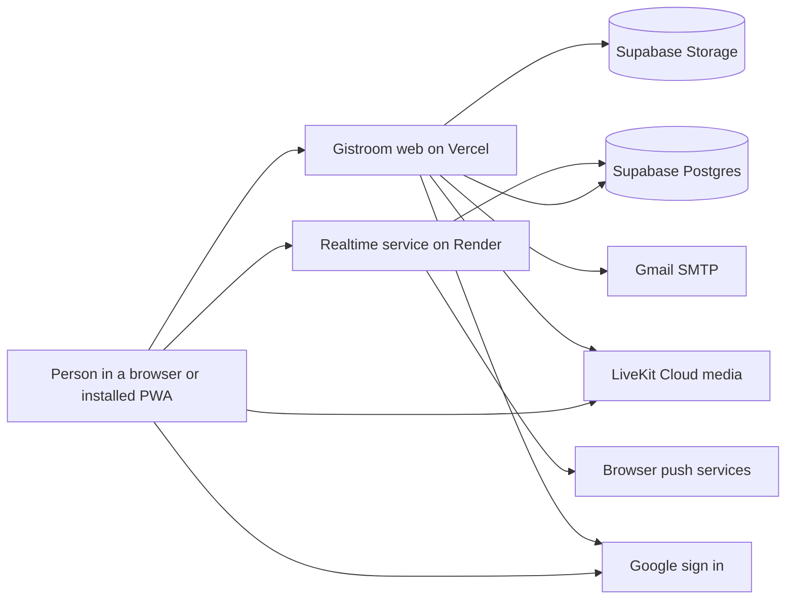

### Components

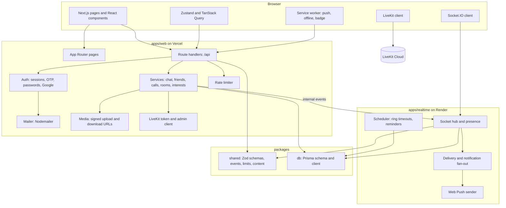

### Use cases

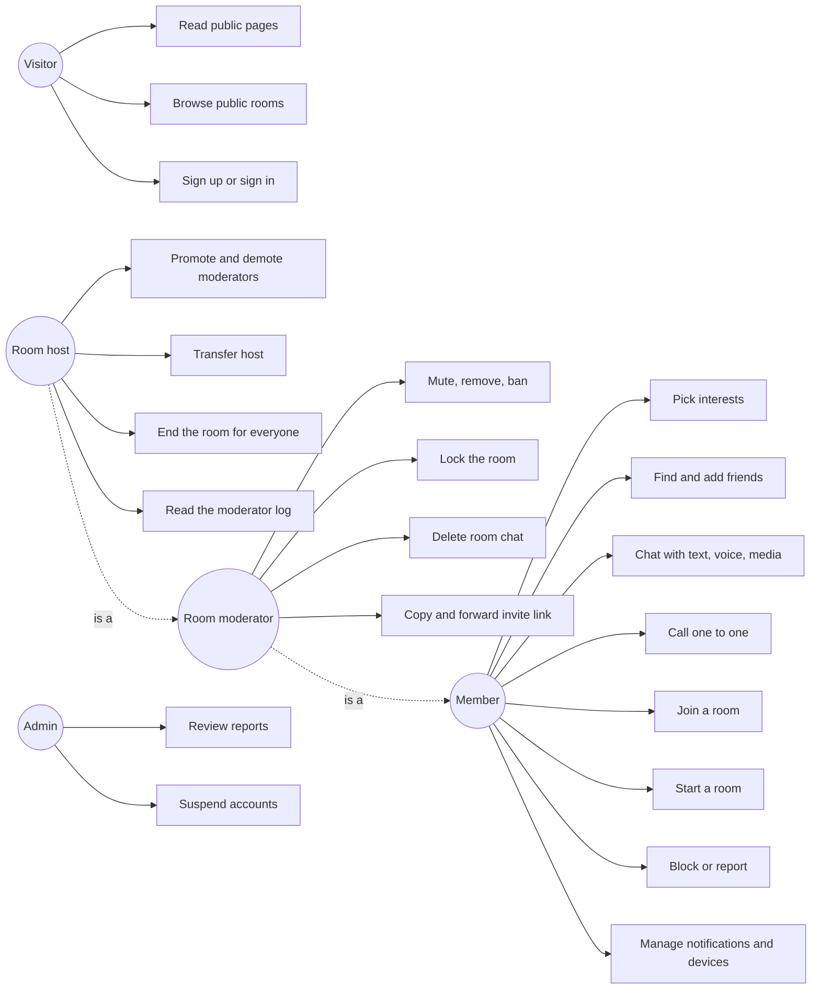

### Sign up and sign in

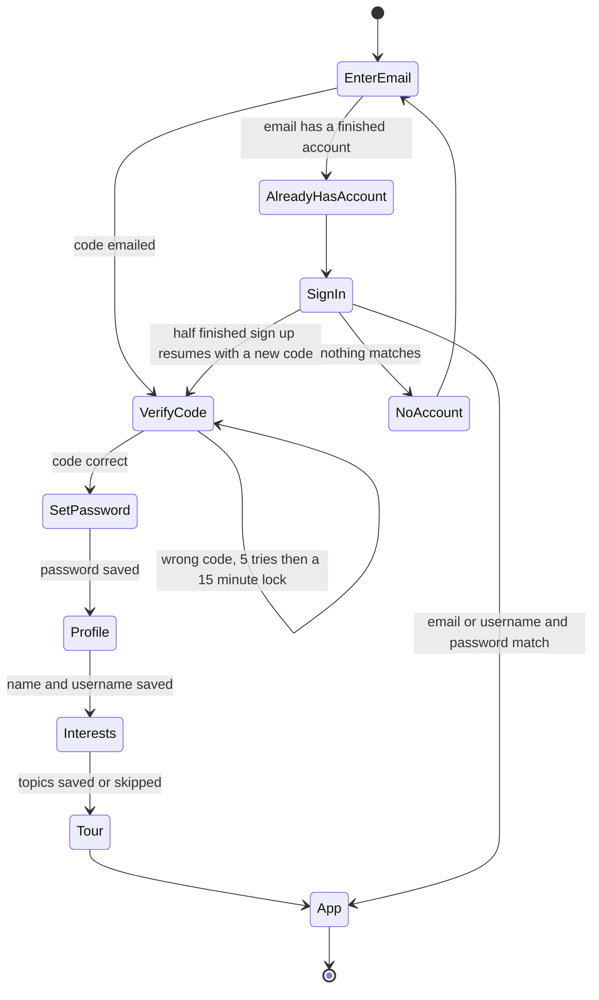

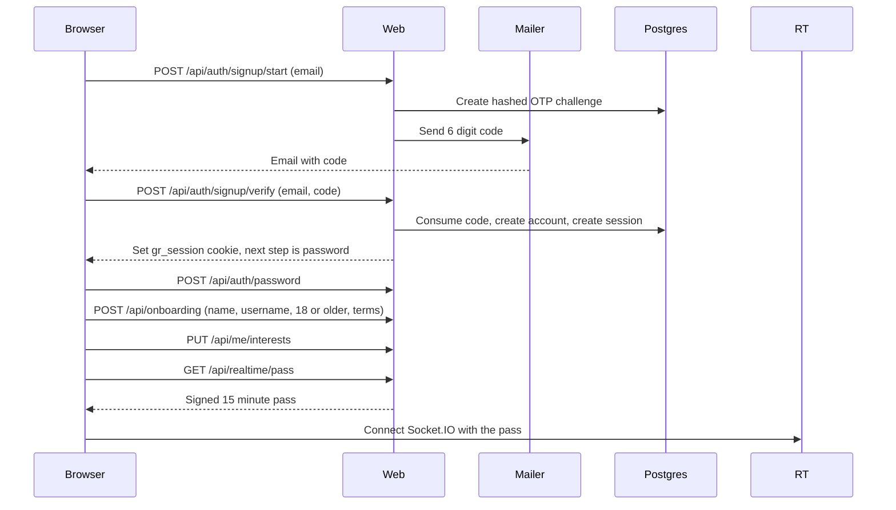

### Sending a message

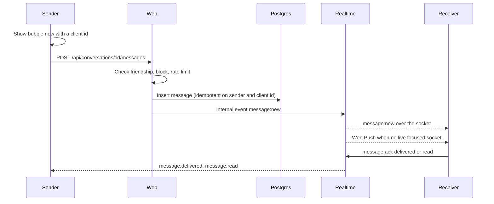

### One to one call

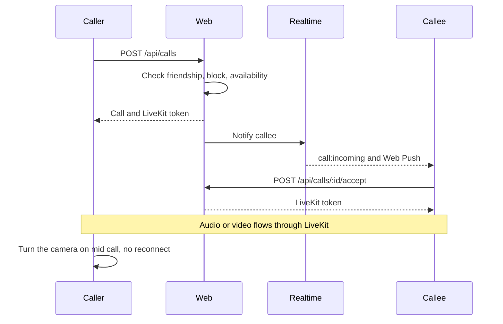

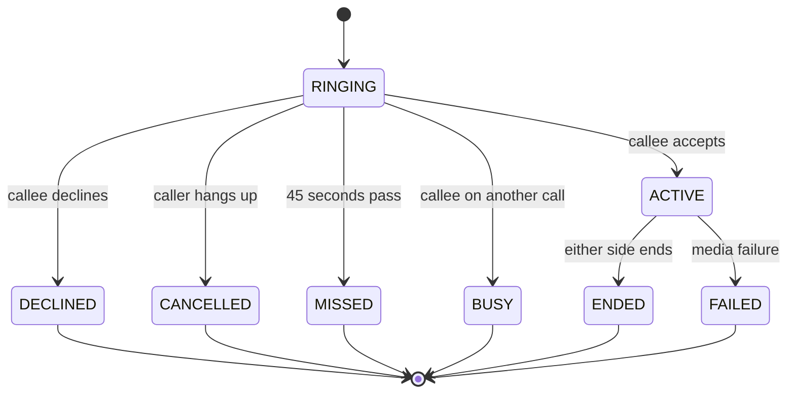

### Rooms

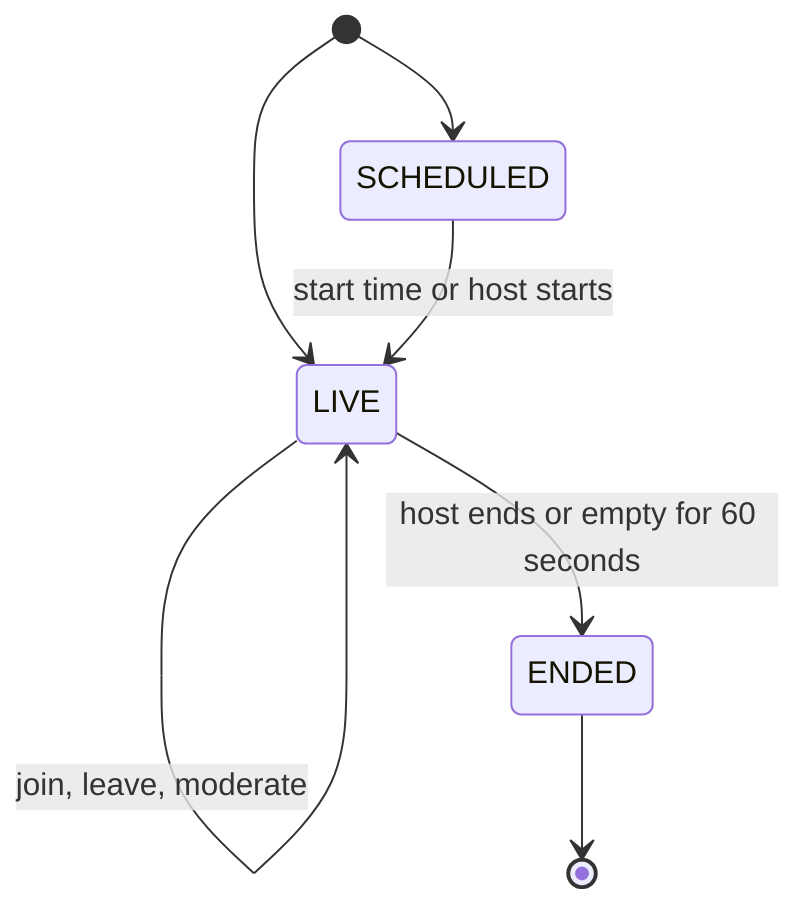

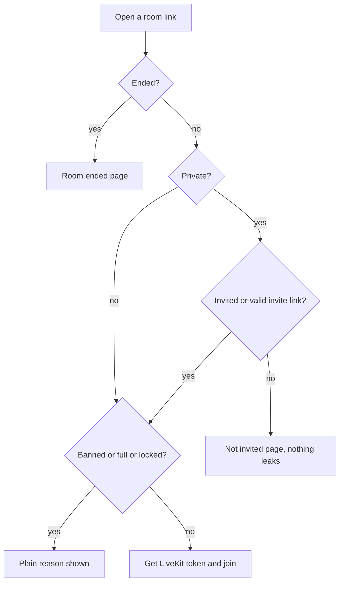

### Friend request states

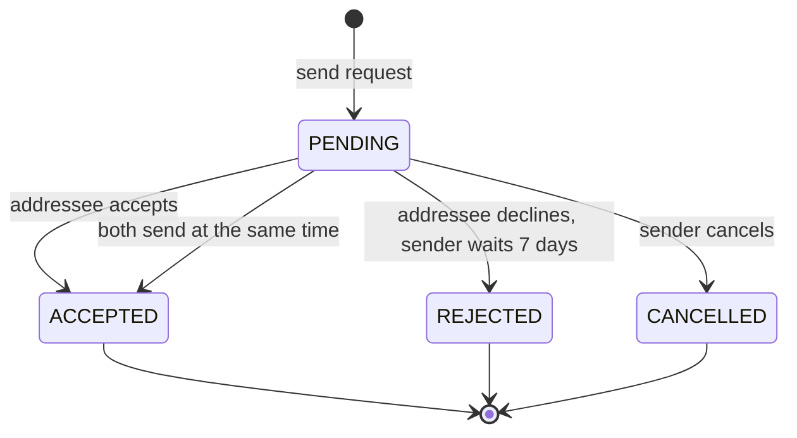

### Notification delivery

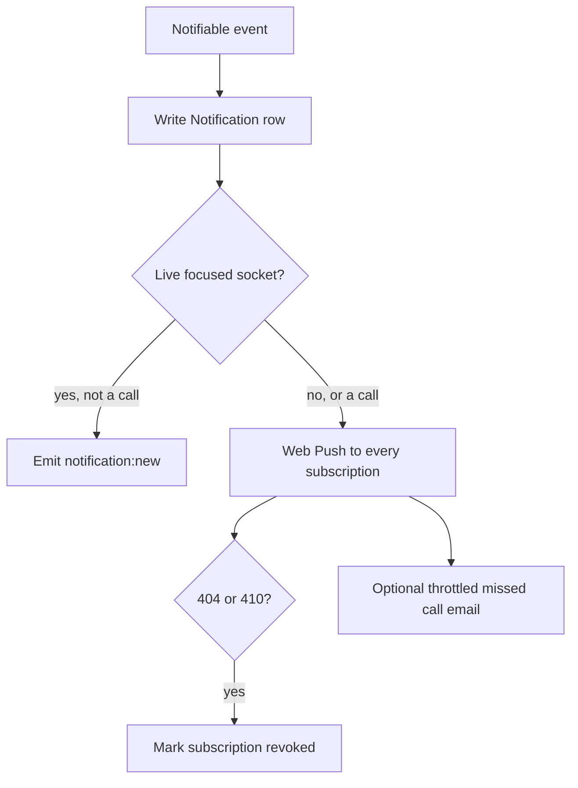

### Data flow

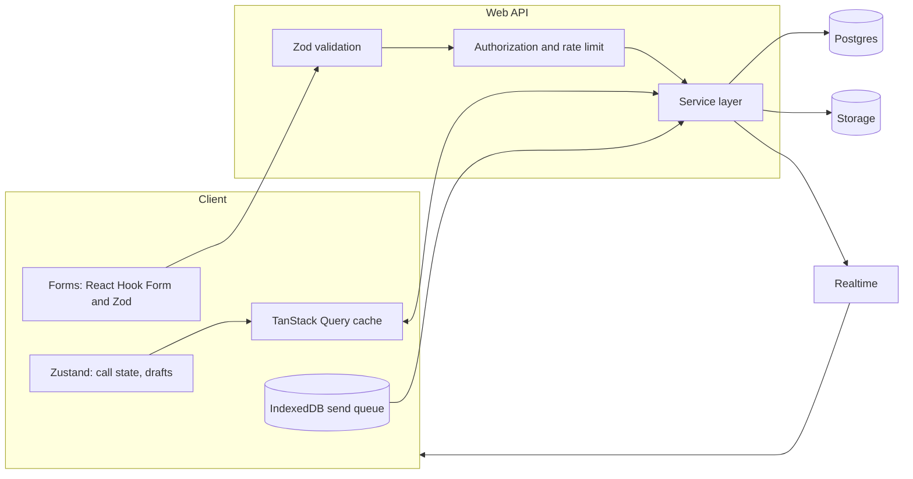

### Data model

The main tables. The full model is in [packages/db/prisma/schema.prisma](packages/db/prisma/schema.prisma).

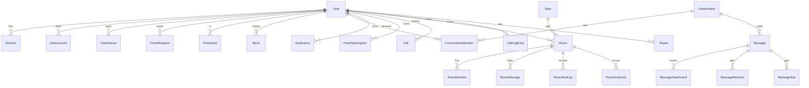

### Deployment

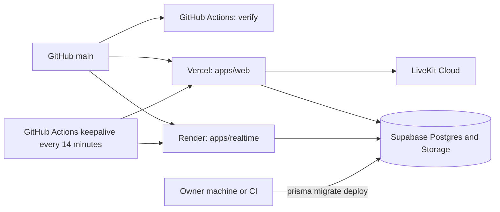

Migrations never run inside a build. The keepalive workflow pings the realtime service so Render does not sleep, and the web health check reads the database so Supabase does not pause.

### Delivery pipeline

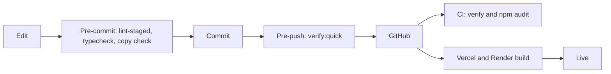

## Repository overview

```
gistroom/
  CLAUDE.md             product spec and engineering rules
  README.md  CHANGELOG.md  SECURITY.md  CONTRIBUTING.md  LICENSE
  apps/
    web/                Next.js app (Vercel)
      src/app/          routes: (public), (auth), (app), api
      src/components/   ui, chat, call, room, landing, public, auth, interests, app
      src/content/      every user facing string
      src/lib/          client helpers
      src/server/       server only code: auth, chat, friends, calls, rooms, interests, mail, media
    realtime/           Express and Socket.IO service (Render)
  packages/
    shared/             Zod schemas, event contracts, limits, shared copy
    db/                 Prisma schema, migrations, client, DTO builders
  design/               graphics manifest, prompts, brand masters, fonts
  scripts/              checkers, graphics generators, brand build, secrets and VAPID tools
  tests/                unit, integration, socket, browser, helpers
  wiki/                 long form documentation
  .github/workflows/    CI and the keepalive pinger
  render.yaml           Render blueprint
```

## Modules

| Module               | Path                                | What it does                                                                 |
| -------------------- | ----------------------------------- | ---------------------------------------------------------------------------- |
| Auth                 | `apps/web/src/server/auth`          | Sessions, OTP, password hashing (scrypt), Google OAuth, account state rules  |
| Friends              | `apps/web/src/server/friends`       | Requests, cooldowns, friendships, blocks, relationship rules                 |
| Chat                 | `apps/web/src/server/chat`          | Conversations, messages, receipts, edits, deletes, stars, reactions, reports |
| Media                | `apps/web/src/server/chat/media.ts` | Signed uploads, magic byte checks, short lived download links                |
| Calls                | `apps/web/src/server/calls`         | Call state machine, glare, busy, call logs                                   |
| Rooms                | `apps/web/src/server/rooms`         | Create, join matrix, moderation, invite links, public listing                |
| Interests            | `apps/web/src/server/interests`     | Topic picks, rooms and people suggestions                                    |
| People search        | `apps/web/src/server/people`        | Trigram search by name and username                                          |
| Notifications        | `apps/web/src/server/notifications` | Notification rows, preferences, push subscriptions                           |
| Mail                 | `apps/web/src/server/mail`          | Template registry, transports (console, capture, smtp), recipient guard      |
| Rate limiting        | `apps/web/src/server/rate-limit.ts` | Database backed limiter with named policies                                  |
| LiveKit              | `apps/web/src/server/livekit.ts`    | Token signing and room admin calls                                           |
| Sockets and delivery | `apps/realtime/src`                 | Hub, presence, delivery, push, scheduler                                     |
| Contracts            | `packages/shared/src`               | Schemas, events, limits, topics, shared content                              |
| Database             | `packages/db`                       | Prisma schema, migrations, DTO builders                                      |
| Service worker       | `apps/web/sw`                       | Push, notification clicks, offline, badge                                    |
| Graphics             | `scripts/graphics`                  | Code drawn avatars, icons, scenes and animated WebP                          |

## Tools and stack

| Concern        | Choice                                                                        |
| -------------- | ----------------------------------------------------------------------------- |
| Language       | TypeScript with `strict` and `noUncheckedIndexedAccess`                       |
| Monorepo       | npm workspaces                                                                |
| Web            | Next.js 16 (App Router, Turbopack), React 19, Tailwind CSS 4, Motion          |
| Forms and data | React Hook Form, Zod, TanStack Query, Zustand                                 |
| UI primitives  | Radix UI, vaul bottom sheets, Lucide icons                                    |
| Realtime       | Express 5, Socket.IO 4, pino, web-push                                        |
| Media          | LiveKit Cloud with `livekit-client`                                           |
| Database       | PostgreSQL on Supabase with Prisma 7                                          |
| Storage        | Supabase Storage                                                              |
| Email          | Nodemailer over Gmail SMTP                                                    |
| PWA            | Serwist core, Web Push with VAPID                                             |
| Quality        | ESLint flat config, Prettier, Husky, lint-staged, custom copy and UI checkers |
| Tests          | Vitest, Playwright with Chromium, axe, socket.io-client                       |
| Hosting        | Vercel (web), Render (realtime), Supabase, LiveKit Cloud                      |
| Font           | Graphik, self hosted                                                          |

## API reference

All routes are under `https://gistroom.vercel.app/api`. Every mutating route checks the `Origin` header, validates input with Zod, rate limits, and authorizes on the server. Errors return `{ error: { code, message, fields? } }`.

### Auth

| Method | Path                      | Purpose                                                                   | Auth    |
| ------ | ------------------------- | ------------------------------------------------------------------------- | ------- |
| POST   | `/auth/identify`          | What to do with an email or username: password, resume, sign up           | none    |
| POST   | `/auth/signup/start`      | Send a code to a new email. Tells you if the email already has an account | none    |
| POST   | `/auth/signup/verify`     | Confirm the code, start a session, return the next step                   | none    |
| POST   | `/auth/password`          | Set the first password                                                    | session |
| POST   | `/auth/login`             | Sign in with email or username and password                               | none    |
| POST   | `/auth/reset/start`       | Send a reset code. Says when there is no account                          | none    |
| POST   | `/auth/reset/verify`      | Code plus new password, signs other devices out                           | none    |
| POST   | `/auth/logout`            | End this session                                                          | session |
| GET    | `/auth/google`            | Start Google sign in (404 while switched off)                             | none    |
| GET    | `/auth/google/callback`   | Finish Google sign in                                                     | none    |
| POST   | `/onboarding`             | Name, username, age and terms                                             | session |
| GET    | `/username/check`         | Is this username free                                                     | session |
| GET    | `/realtime/pass`          | Signed 15 minute socket pass                                              | session |
| GET    | `/sessions`               | Active devices                                                            | session |
| DELETE | `/sessions/:id`           | Sign out one device                                                       | session |
| POST   | `/sessions/revoke-others` | Sign out every other device                                               | session |

### Profile, friends and discovery

| Method    | Path                                      | Purpose                                        |
| --------- | ----------------------------------------- | ---------------------------------------------- |
| GET, PUT  | `/me`                                     | Read or update my profile and privacy settings |
| POST      | `/me/password`                            | Change password                                |
| GET, PUT  | `/me/interests`                           | Read or replace my interests                   |
| GET       | `/discover`                               | Rooms and people that match my interests       |
| GET       | `/people/search`                          | Search by name or username                     |
| GET       | `/users/:username`                        | A public profile                               |
| POST      | `/avatar/sign`, `/avatar/commit`          | Upload a profile photo                         |
| GET, POST | `/friends`, `/friends/requests`           | List friends, send a request                   |
| POST      | `/friends/requests/:id/accept`, `/reject` | Answer a request                               |
| DELETE    | `/friends/:userId`                        | Unfriend                                       |
| POST      | `/blocks`, DELETE `/blocks/:userId`       | Block and unblock                              |

### Chat and media

| Method             | Path                                            | Purpose                                           |
| ------------------ | ----------------------------------------------- | ------------------------------------------------- |
| GET, POST          | `/conversations`                                | List chats, open or create one                    |
| GET, PATCH, DELETE | `/conversations/:id`                            | Details, archive or mute, clear                   |
| GET, POST          | `/conversations/:id/messages`                   | Page of messages, send (idempotent on client id)  |
| POST               | `/conversations/:id/read`                       | Advance the read cursor                           |
| POST               | `/conversations/:id/report`                     | Report with the last 20 messages                  |
| GET                | `/conversations/:id/attachments`                | Media, files, voice notes                         |
| PATCH, DELETE      | `/messages/:id`                                 | Edit within 15 minutes, delete for me or everyone |
| PUT, DELETE        | `/messages/:id/star`, `/messages/:id/reactions` | Star and react                                    |
| GET                | `/starred`                                      | Starred messages                                  |
| POST               | `/media/sign`                                   | Signed upload URL                                 |
| GET                | `/media/:id`                                    | Authorized redirect to a short lived URL          |

### Calls

| Method    | Path                                                           | Purpose                |
| --------- | -------------------------------------------------------------- | ---------------------- |
| GET, POST | `/calls`                                                       | Call log, start a call |
| GET       | `/calls/:id`                                                   | One call               |
| POST      | `/calls/:id/accept`, `/decline`, `/cancel`, `/end`, `/timeout` | Call lifecycle         |

### Rooms

| Method             | Path                    | Purpose                            |
| ------------------ | ----------------------- | ---------------------------------- |
| GET, POST          | `/rooms`                | My rooms, create a room            |
| GET, PATCH, DELETE | `/rooms/:slug`          | View, edit or lock, end            |
| POST               | `/rooms/:slug/join`     | Join and get a LiveKit token       |
| GET, POST          | `/rooms/:slug/session`  | Seat and rejoin handling           |
| GET                | `/rooms/:slug/people`   | Members                            |
| POST               | `/rooms/:slug/moderate` | Mute, remove, ban, promote, demote |
| GET, POST          | `/rooms/:slug/chat`     | Room chat                          |
| GET, POST          | `/rooms/:slug/invites`  | Invite links, invite or forward    |
| GET                | `/public/rooms`         | Public live and scheduled rooms    |
| GET                | `/public/stats`         | Count of live public rooms         |

### Notifications, push and system

| Method    | Path                               | Purpose                                  |
| --------- | ---------------------------------- | ---------------------------------------- |
| GET, POST | `/notifications`                   | List, mark read or delete                |
| GET, PUT  | `/notifications/preferences`       | Per type switches, previews, quiet hours |
| GET       | `/notifications/unread`, `/unread` | Unread counts                            |
| POST      | `/push/subscribe`                  | Register a Web Push subscription         |
| POST      | `/notifications/test`              | Send myself a test notification          |
| POST      | `/consent`                         | Store cookie consent                     |
| POST      | `/contact`                         | Contact form                             |
| POST      | `/csp-report`                      | Content Security Policy reports          |
| GET       | `/health`                          | Liveness plus a database read            |
| GET       | `/internal/jobs/sweep`             | Daily cleanup and catch up (cron secret) |

## Realtime events

Defined once in [packages/shared/src/events.ts](packages/shared/src/events.ts).

| Event                                                                      | Direction        | Purpose                                |
| -------------------------------------------------------------------------- | ---------------- | -------------------------------------- |
| `presence:update`                                                          | server to client | Friend online or offline               |
| `typing:start`, `typing:stop`                                              | both ways        | Typing preview                         |
| `message:new`, `message:updated`                                           | server to client | New, edited, deleted, starred, reacted |
| `message:ack`                                                              | client to server | Delivered or read cursor               |
| `message:delivered`, `message:read`                                        | server to client | Receipts                               |
| `friend:request`, `friend:accepted`                                        | server to client | Social graph changes                   |
| `notification:new`, `badge:update`                                         | server to client | In app notices and counts              |
| `call:incoming`, `call:cancelled`, `call:answered_elsewhere`, `call:ended` | server to client | One to one signaling                   |
| `room:invite`, `room:started`, `room:ended`, `room:member_updated`         | server to client | Room lifecycle                         |
| `room:chat:new`                                                            | server to client | Room chat message                      |
| `session:revoked`                                                          | server to client | Force sign out                         |

## Environment variables

Every key is listed and commented in [.env.example](.env.example). Both apps validate their environment with Zod at boot. Only `NEXT_PUBLIC_*` values reach the browser. LiveKit secrets live on web only.

| Group         | Keys                                                                                                                                                   |
| ------------- | ------------------------------------------------------------------------------------------------------------------------------------------------------ |
| URLs          | `APP_URL`, `NEXT_PUBLIC_APP_URL`, `REALTIME_URL`, `NEXT_PUBLIC_REALTIME_URL`                                                                           |
| Database      | `DATABASE_URL` (pooled), `DIRECT_URL`, `DATABASE_SCHEMA`, `PRODUCTION_DB_HOST`                                                                         |
| Secrets       | `SESSION_SECRET`, `REALTIME_PASS_SECRET`, `INTERNAL_SERVICE_TOKEN`, `CRON_SECRET`                                                                      |
| Google        | `GOOGLE_CLIENT_ID`, `GOOGLE_CLIENT_SECRET`, `GOOGLE_REDIRECT_URI`, `GOOGLE_MODE`, `GOOGLE_AUTH_ENABLED`, `NEXT_PUBLIC_GOOGLE_AUTH_ENABLED`             |
| Email         | `MAIL_TRANSPORT`, `MAIL_ENABLE_REAL`, `MAIL_ALLOWED_DOMAINS`, `MAIL_FROM_NAME`, `MAIL_FROM_ADDRESS`, `SMTP_USER`, `SMTP_APP_PASSWORD`, `SUPPORT_INBOX` |
| Storage       | `SUPABASE_URL`, `NEXT_PUBLIC_SUPABASE_URL`, `SUPABASE_SERVICE_ROLE_KEY`, `SUPABASE_MEDIA_BUCKET`, `SUPABASE_PUBLIC_BUCKET`                             |
| LiveKit       | `LIVEKIT_URL`, `NEXT_PUBLIC_LIVEKIT_URL`, `LIVEKIT_API_KEY`, `LIVEKIT_API_SECRET`                                                                      |
| Web Push      | `NEXT_PUBLIC_VAPID_PUBLIC_KEY`, `VAPID_PUBLIC_KEY`, `VAPID_PRIVATE_KEY`, `VAPID_SUBJECT`                                                               |
| Realtime only | `PORT`, `WEB_APP_URL`, `ALLOWED_ORIGINS`, `LOG_LEVEL`                                                                                                  |

## Quick start

```bash
npm install
cp .env.example .env              # PowerShell: Copy-Item .env.example .env
node scripts/gen-secrets.mjs      # paste the output into .env
node scripts/gen-vapid.mjs        # paste the VAPID keys into .env
npm run dev
```

Web runs on http://localhost:3000 and the realtime service on http://localhost:4000. Development and tests use the hosted Supabase project through isolated schemas (`gistroom_dev`, `gistroom_test`). There is no Docker and no local database. Details are in [wiki/Deployment.md](wiki/Deployment.md).

## Commands

| Command                                                | What it does                                          |
| ------------------------------------------------------ | ----------------------------------------------------- |
| `npm run dev`                                          | web and realtime together                             |
| `npm run build`                                        | Prisma client, shared, web, realtime                  |
| `npm run verify`                                       | the full pipeline, must be green before a commit      |
| `npm run verify:quick`                                 | copy, ui, lint, typecheck, unit tests                 |
| `npm run lint:copy`                                    | no emojis, no long dashes, no banned phrases          |
| `npm run lint:ui`                                      | UI rules (no toasts, no native select, tokens only)   |
| `npm run lint:font`                                    | Graphik glyph coverage with the Noto Sans fallback    |
| `npm run lint:graphics`                                | illustration manifest, budgets, brand exports         |
| `npm run test:unit`, `test:integration`, `test:socket` | Vitest projects                                       |
| `npm run test:browser`, `test:a11y`, `test:responsive` | Playwright suites                                     |
| `npm run brand`                                        | rebuild logo, icons and the default share image       |
| `npm run db:diff -- name`                              | write a migration from the schema, no database needed |
| `npm run db:migrate`                                   | migrations against the dev schema only                |
| `npm run db:seed`, `db:reset`, `db:studio`             | dev schema only, through `assert-safe-db`             |
| `npm run storage:setup`                                | create the Supabase storage buckets                   |

## Testing

Unit tests cover schemas, rules, state machines, token signing, copy and UI checkers, SEO helpers and the graphics manifest. Integration tests run against the `gistroom_test` schema, socket tests use `socket.io-client`, and Playwright covers browser, accessibility and responsive checks. See [wiki/Testing.md](wiki/Testing.md).

## Security

- Passwords use scrypt. Sessions are opaque tokens stored hashed in an `httpOnly` cookie.
- Codes are HMAC hashed with a pepper, expire in 10 minutes, and lock after 5 wrong tries.
- Every mutation is rate limited, validated with Zod and authorized on the server. Every socket event is authorized on its own.
- A per request nonce Content Security Policy, HSTS, and strict permissions policy.
- Uploads are validated by magic bytes and size, and EXIF is stripped from images.
- Secrets live only in environment variables and are never committed.

Report a vulnerability to `security@gistroom.ng`. See [SECURITY.md](SECURITY.md).

## Deployment guide

Two deployments only: `apps/web` on Vercel and `apps/realtime` on Render. Supabase and LiveKit are hosted services. Steps are in [wiki/Deployment.md](wiki/Deployment.md). The Render blueprint is [render.yaml](render.yaml).

## Status and roadmap

| Phase | Scope                                | State                                                 |
| ----- | ------------------------------------ | ----------------------------------------------------- |
| 0     | Foundation, tooling, brand, landing  | Done                                                  |
| 1     | Identity: accounts, sessions, search | Done                                                  |
| 2     | Friends, chat, notifications, PWA    | Done                                                  |
| 3     | Chat media, voice notes, reactions   | Done                                                  |
| 4     | One to one calls and call logs       | Done                                                  |
| 5     | Rooms                                | Done                                                  |
| 6     | Public site and polish               | Done, graphics are code drawn drafts for owner review |
| 7     | Admin console, audits, launch        | Next                                                  |

## Launch checklist

- [x] Supabase project created and migrations applied
- [x] Vercel and Render projects live, health checks green
- [x] Uptime keepalive on both services
- [ ] `gistroom.ng` DNS, `www` redirect to the apex
- [ ] Google consent screen published to production, then `GOOGLE_AUTH_ENABLED=true`
- [x] Gmail app password, mail transport set to `smtp`
- [x] VAPID keys generated and set on both services
- [ ] All illustrations reviewed and approved
- [ ] A private bucket for chat media (today one public bucket is shared, see decision D39)
- [ ] Legal pages reviewed against the NDPA and the Cybercrimes Act
- [ ] Graphik web license confirmed (D7)
- [ ] Sitemap submitted in Search Console

## Documentation

[Wiki home](wiki/Home.md) · [Architecture](wiki/Architecture.md) · [Auth](wiki/Auth.md) · [Chat](wiki/Chat.md) · [Calls](wiki/Calls.md) · [Rooms](wiki/Rooms.md) · [Security](wiki/Security.md) · [Design system](wiki/Design-System.md) · [Decisions](wiki/Decisions.md) · [Contributing](CONTRIBUTING.md) · [Changelog](CHANGELOG.md)

## Contact

Built by **Oyedokun Ken** ([@oyedokunken](https://github.com/oyedokunken)).

- Portfolio: [oyedokun.dev](https://www.oyedokun.dev/)
- GitHub: [github.com/oyedokunken](https://github.com/oyedokunken)
- Security reports: `security@gistroom.ng`
- Support: `support@gistroom.ng`

Copyright 2026 Oyedokun Ken. All rights reserved. See [LICENSE](LICENSE).
