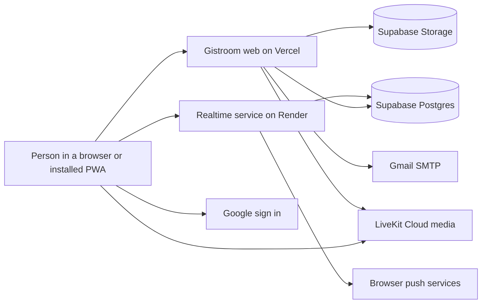
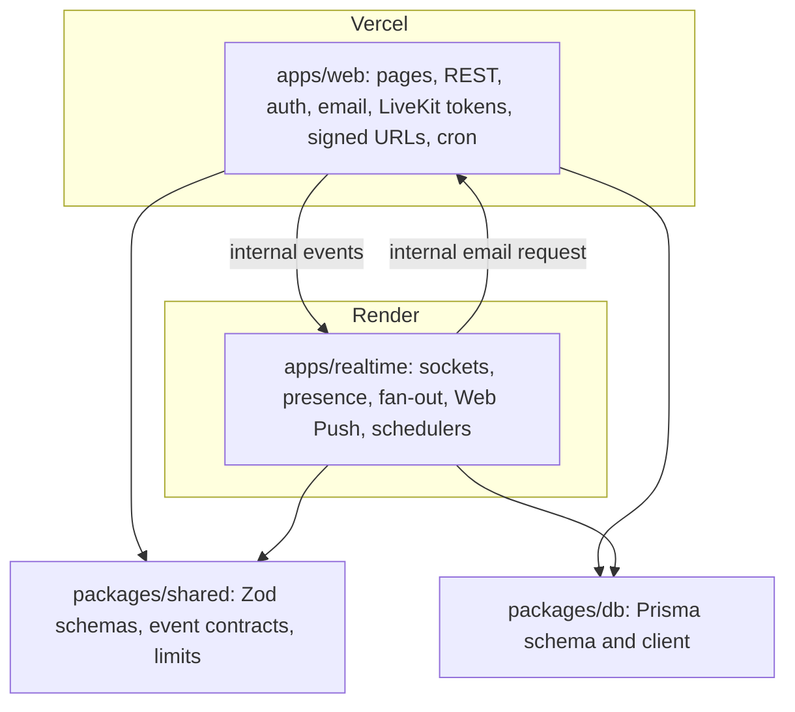
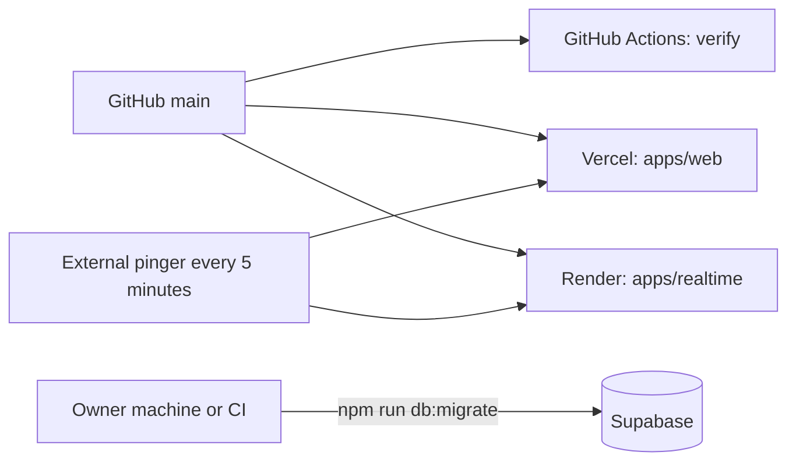
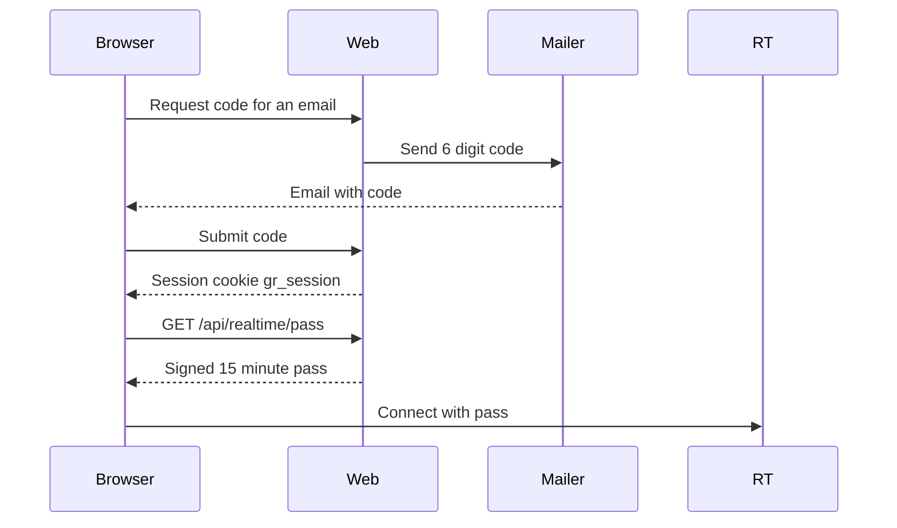
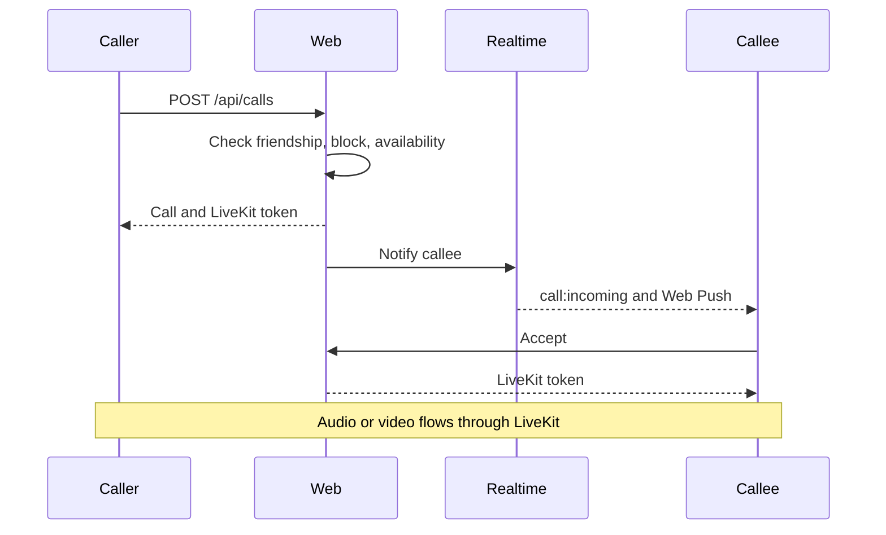
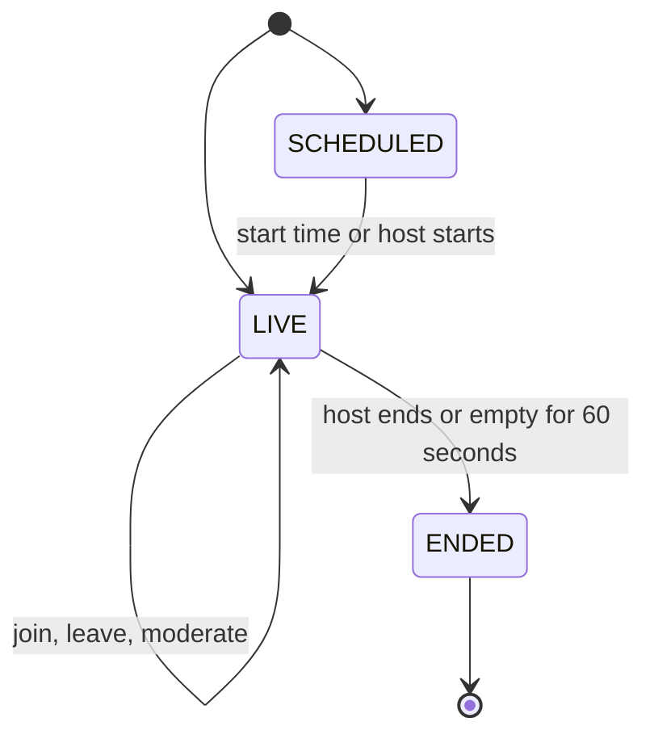
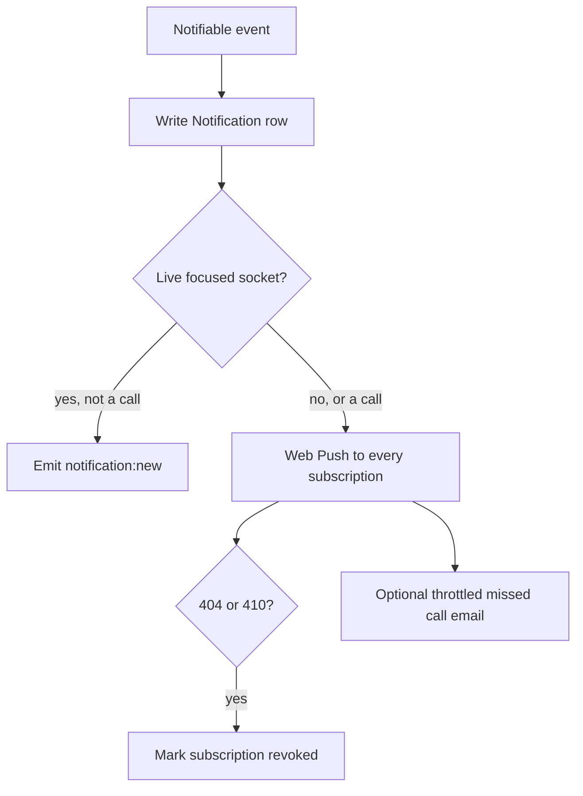

# Gistroom

Live talk about Nigeria, in Nigeria. Friends, chats, calls and Rooms. Audio first, built for Nigerian data.

Status: Phase 0 (foundation) is done except the first deploy. The full spec is in [CLAUDE.md](CLAUDE.md). Domain: `gistroom.ng`.

Screenshots arrive with the first approved illustrations (see [wiki/Graphics.md](wiki/Graphics.md)).

## Quick start

```bash
npm install
cp .env.example .env        # PowerShell: Copy-Item .env.example .env
node scripts/gen-secrets.mjs   # paste the output into .env
npm run dev
```

Web runs on http://localhost:3000 and the realtime service on http://localhost:4000. Dev and tests use the hosted Supabase project through isolated schemas (`gistroom_dev`, `gistroom_test`). There is no Docker and no local database.

## Architecture

### System context



### Containers



### Deployment



Migrations never run inside a build. Email is sent only from the web app because Render free blocks outbound SMTP.

### Auth flow



### Call flow



### Room lifecycle



### Notification delivery



## Environment variables

Every key is listed and commented in [.env.example](.env.example). Both apps validate their environment with Zod at boot. Only `NEXT_PUBLIC_*` values reach the browser. LiveKit secrets live on web only.

## Commands

| Command                                    | What it does                                         |
| ------------------------------------------ | ---------------------------------------------------- |
| `npm run dev`                              | web and realtime together                            |
| `npm run build`                            | Prisma client, shared, web, realtime                 |
| `npm run verify`                           | the full pipeline, must be green before a commit     |
| `npm run verify:quick`                     | copy, ui, lint, typecheck, unit tests                |
| `npm run lint:copy`                        | no emojis, no long dashes, no banned phrases         |
| `npm run lint:ui`                          | UI rules (no toasts, no native select, tokens only)  |
| `npm run lint:font`                        | Graphik glyph coverage with the Noto Sans fallback   |
| `npm run lint:graphics`                    | illustration manifest, budgets, brand exports        |
| `npm run brand`                            | rebuild logo, icons and the default share image      |
| `npm run graphics:placeholders`            | rebuild the asset manifest, prompts and placeholders |
| `npm run db:migrate`                       | migrations against the dev schema only               |
| `npm run db:seed`, `db:reset`, `db:studio` | dev schema only, through `assert-safe-db`            |

## Deployment

Two deployments only: `apps/web` on Vercel and `apps/realtime` on Render. Supabase and LiveKit are hosted services. Steps are in [wiki/Deployment.md](wiki/Deployment.md). The Render blueprint is [render.yaml](render.yaml).

## Tests

Unit tests run today. Integration, socket, browser, accessibility and responsive suites arrive from Phase 1, and `npm run verify` already has a slot for each. See [wiki/Testing.md](wiki/Testing.md).

## Launch checklist

- [ ] Supabase project created and `gistroom_dev` and `gistroom_test` schemas migrated
- [ ] Vercel and Render projects live, health checks green
- [ ] Uptime pinger on both `/health` and `/api/health`
- [ ] `gistroom.ng` DNS, `www` redirect to the apex
- [ ] Google OAuth credentials and redirect URIs
- [ ] Gmail app password, mail transport set to `smtp`
- [ ] VAPID keys generated and set on both services
- [ ] All illustrations approved (no PLACEHOLDER)
- [ ] Legal pages reviewed against the NDPA and the Cybercrimes Act
- [ ] Graphik web license confirmed (D7)
- [ ] Sitemap submitted in Search Console

## Docs

[Wiki home](wiki/Home.md), [Decisions](wiki/Decisions.md), [Security policy](SECURITY.md), [Contributing](CONTRIBUTING.md), [Changelog](CHANGELOG.md).
